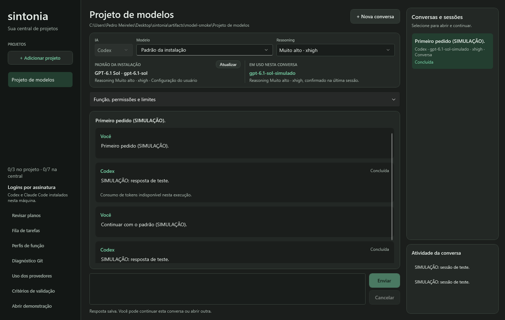
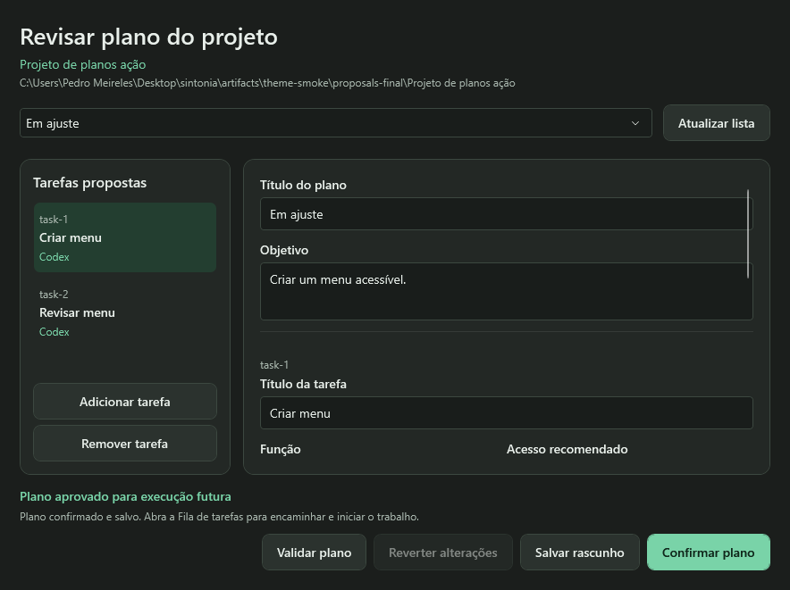
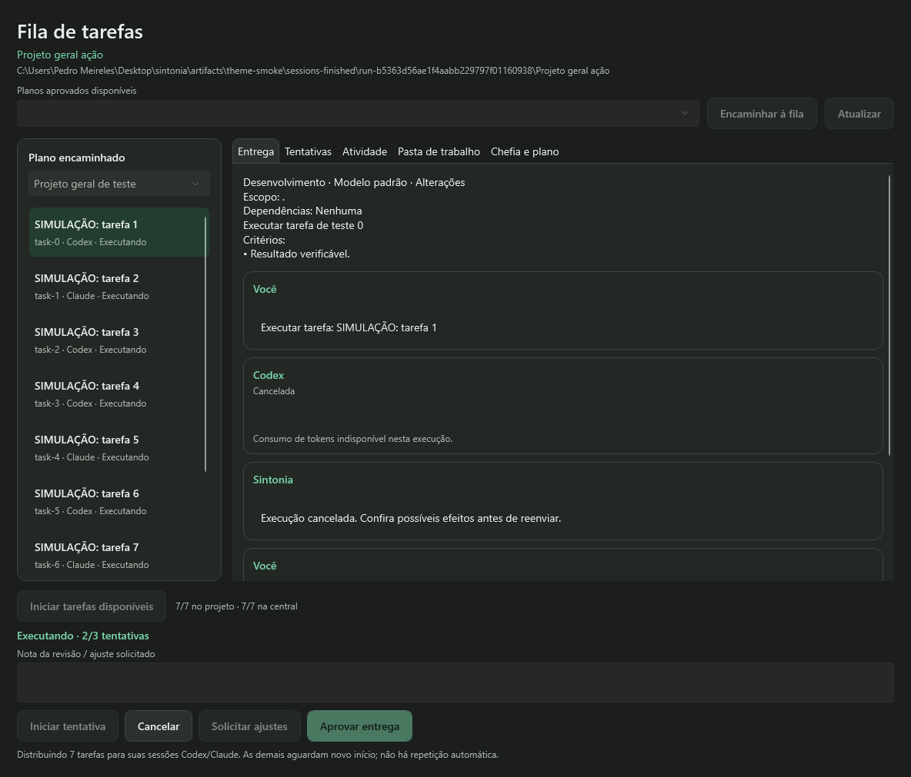
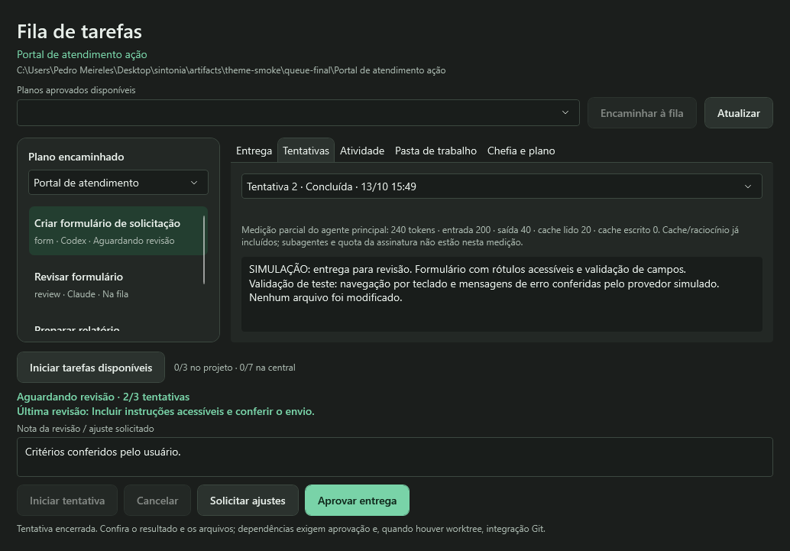

# Sintonia

Central desktop para Windows que conecta sessões do **Codex** e do **Claude** em múltiplos projetos. Desenvolvida em **C#/.NET 10 e WPF**, reúne conversas, planejamento, tarefas, revisão de entregas e integração Git numa interface em português.

Cada projeto mantém seu contexto e histórico. Os agentes executam o trabalho com as ferramentas de suas instalações; o Sintonia encaminha instruções e resultados, coordena dependências e acompanha as entregas.

**Estado: MVP funcional para uso local.** Chat, sessões persistentes, fila, chefia e integração Git assistida estão implementados. A distribuição para outras máquinas e parte das validações de compatibilidade permanecem no [roadmap](ROADMAP.md).



A interface usa grafite, painéis discretos e verde suave para ações e seleções. A captura acima usa provedores simulados; as execuções reais têm [evidências próprias](docs/REAL_COLLABORATION.md). Consulte a [paleta e a validação do tema](docs/DARK_THEME.md).

## Funcionalidades

- **Múltiplos projetos:** cadastre pastas e alterne entre conversas, tarefas e sessões com contexto separado.
- **Chat com Codex e Claude:** escolha provedor, modelo e reasoning, veja o padrão da instalação e a versão em uso, acompanhe respostas e eventos, cancele execuções e retome conversas. [Modelos e reasoning](docs/MODEL_SETTINGS.md).
- **Perfis de função:** reutilize instruções e padrões de provedor/modelo para desenvolvimento, revisão, documentação, análise e outras tarefas.
- **Chefia e planos revisáveis:** transforme um objetivo em uma proposta de tarefas, edite responsáveis, escopos, dependências e critérios e confirme o plano antes de encaminhá-lo à fila.
- **Fila persistente:** inicie tarefas, revise resultados, solicite ajustes na mesma sessão e aprove entregas para liberar dependências.
- **Trabalho paralelo com Git:** prepare worktrees distintas, confira diffs e conflitos, registre commits revisados e combine entregas em uma pasta separada.
- **Validação e publicação assistidas:** configure comandos por projeto, valide a combinação e confirme sua publicação na branch local. A publicação pelo Sintonia não faz push para o remoto.
- **Histórico local:** projetos, conversas, tentativas, eventos, planos e entregas ficam em SQLite e são preservados ao reabrir o aplicativo.
- **Permissões e limites:** responda a autorizações por ação e perguntas do Claude, configure concorrência, tentativas e prazo e acompanhe quota Codex e tokens informados por execução.

Código, documentos, análises e outros arquivos seguem o fluxo geral de tarefas e entregas. A disponibilidade de ferramentas para produzi-los depende da instalação de cada agente.

## Como funciona

1. **Cadastre um projeto** em **Adicionar projeto** e escolha a pasta de trabalho.
2. **Converse ou planeje:** selecione Codex/Claude, o modelo e o reasoning. Para distribuir trabalho, use a função **Chefe do projeto** e descreva o objetivo.
3. **Revise o plano** em **Revisar planos**, ajuste as tarefas e confirme. Em **Fila de tarefas**, use **Encaminhar à fila**. Essas confirmações não iniciam modelos.
4. **Prepare e execute:** para escrita paralela, prepare uma worktree por tarefa em **Pasta de trabalho**. Use **Iniciar tentativa** ou **Iniciar tarefas disponíveis** e responda às solicitações de permissão.
5. **Revise as entregas:** confira respostas, arquivos e critérios; aprove ou solicite ajustes. Para entregas em worktree, salve as mudanças em um commit e use **Registrar commit revisado** após conferir os diffs.
6. **Integre o resultado:** prepare a combinação, execute os critérios de validação e confirme **Publicar no projeto**. Dependentes exigem a entrega aprovada e a revisão publicada presente em sua pasta de trabalho.

A chefia pode receber os resultados pelo chat e propor ajustes para tarefas ainda não iniciadas. Envio, revisão, início de tarefas e publicação continuam explícitos. Veja os guias de [chefia](docs/PLAN_UPDATES.md), [fila](docs/TASK_QUEUE.md) e [integração Git](docs/TASK_PUBLICATION.md).

<details>
<summary>Mais capturas da interface</summary>

As capturas abaixo usam dados e provedores de teste; as operações Git usam repositórios reais em pastas de teste.







</details>

## Executar a partir do código

O projeto ainda não oferece instalador ou pacote de release. Para compilar e executar:

- Windows com uma sessão gráfica para a interface WPF.
- SDK **.NET 10**, na linha **10.0.200** definida em [global.json](global.json), com atualizações de patch permitidas.
- Codex CLI e/ou Claude Code disponíveis no `PATH`, em um layout de instalação suportado, com login por assinatura realizado em seus próprios CLIs.
- Git para os fluxos de worktrees, diffs e integração. Projetos sem Git continuam usando chat e fila, com escrita direta exclusiva.

As versões registradas nas provas são **Codex CLI 0.162.0-alpha.2** e **Claude Code 2.1.277**. Outras versões e layouts precisam de verificação; encontrar um executável não comprova autenticação, quota ou compatibilidade completa. Veja [instalações e provas dos provedores](docs/PROVIDER_PROBES.md).

Na raiz do repositório:

```powershell
rtk proxy dotnet restore Sintonia.sln --locked-mode
rtk proxy dotnet build Sintonia.sln --no-restore
rtk proxy dotnet run --project src/Sintonia.Desktop --no-build
```

O RTK é usado no ambiente de desenvolvimento deste projeto; o aplicativo não depende dele. Em outro ambiente, execute os mesmos comandos começando por `dotnet`.

A integração usa os logins por assinatura das instalações locais: ChatGPT no Codex e `claude.ai` no Claude. Não há configuração de chaves de API nem mudança automática para cobrança de API. Cada provedor conserva suas instruções, skills, plugins e MCPs compatíveis; recursos exclusivos dos aplicativos desktop e autenticações de conectores têm [limites documentados](docs/PROVIDER_EXTENSIONS.md).

O histórico fica em `%LOCALAPPDATA%/Sintonia/workspace.db`. Ao reabrir, execuções abandonadas são identificadas como interrompidas, sem reenvio automático. O botão **Abrir demonstração** oferece o fluxo inicial inteiramente simulado, separado da central real.

## Limites atuais

- **Concorrência:** de 3 a 7 execuções simultâneas por projeto, padrão 3, até 7 globalmente. Chat, chefia e fila compartilham as vagas; manter sessões abertas não ocupa uma vaga sem execução. Escrita paralela exige worktrees distintas e validadas; escrita direta permanece exclusiva.
- **Tentativas e prazo:** de 1 a 3 tentativas por tarefa e de 1 a 300 segundos por execução, configuráveis por projeto. Não há rodadas ou reenvios automáticos. Cancelar uma execução não desfaz arquivos já alterados.
- **Permissões:** o Sintonia usa decisões por ação e preserva regras e hooks dos provedores. O host Claude recusa `ExitPlanMode` e solicitações de dados MCP (elicitation); não oferece aprovação desses controles. A recusa em URL mode ainda não tem prova real. Permissões e worktrees não equivalem a isolamento do sistema operacional.
- **Extensões e sessões:** a compatibilidade de todos os MCPs e ferramentas ainda não foi demonstrada. Não há importação ou controle geral de conversas externas, nem garantia de abrir as sessões nos aplicativos gráficos originais. Trabalho autônomo em background após o resultado terminal ainda não tem acompanhamento.
- **Consumo:** quota Codex pode ser consultada; quota Claude está indisponível pela integração. Tokens cobrem a medição informada do agente principal, com dados parciais ou ausentes identificados. O limite agregado controla a admissão de novos envios; execuções ativas podem ultrapassar a reserva. Esses valores não representam custo nem saldo da assinatura.
- **Arquivamento:** worktrees de entregas publicadas podem ser arquivadas preservando arquivos, branch e histórico. O arquivo continua ocupando espaço; combinações permanecem. Restauração e descarte automático não estão implementados.

O MVP corresponde ao M2; os fluxos Git do M3 e a distribuição assistida do M4 também estão implementados. M1 conserva lacunas de compatibilidade, M6 ainda pede exemplos de projetos distintos e M7 reúne pacote Windows, teste em outra máquina, licença, automação de build/testes e atualização com preservação de dados. Consulte os critérios no [roadmap](ROADMAP.md).

## Validação e evidências

Codex e Claude já executaram tarefas reais por assinatura, com leitura, retomada e interrupção verificadas. Uma [prova finita de colaboração com Git](docs/REAL_COLLABORATION.md) combinou JSON produzido pelo Codex e documentação Markdown produzida pelo Claude, com dependência, revisão, validação, publicação e histórico preservados.

O Claude tem provas delimitadas de recusa/autorização de [Write](docs/PROVIDER_PROBES.md), [Bash/Edit](docs/CLAUDE_TOOL_PERMISSIONS.md) e [leitura MCP pública](docs/CLAUDE_MCP_PERMISSIONS.md), além de [pergunta simples respondida pelo callback](docs/CLAUDE_QUESTIONS.md), [elicitation form recusada sem modelo](docs/CLAUDE_ELICITATION.md) e [recusa real de ExitPlanMode](docs/CLAUDE_PLAN_EXIT.md). Cada prova registra seu alcance e suas limitações.

Testes automatizados usam provedores simulados e processos de teste, com Git real quando necessário. Os testes WPF verificam fluxos e bindings em uma sessão Windows. Provas reais de modelos são opt-in, têm limites e não devem ser executadas em loops ou CI. Resultados de builds, seleções de testes e capturas estão no [registro de desenvolvimento](docs/DEVELOPMENT_LOG.md).

Para verificar o código já compilado:

```powershell
rtk proxy dotnet test Sintonia.sln --no-build
rtk proxy dotnet run --project tests/Sintonia.Desktop.SmokeTests --no-build -- --workspace
```

O teste WPF é um executável separado de `dotnet test`. Outros fluxos e instruções de desenvolvimento estão em [CONTRIBUTING.md](CONTRIBUTING.md) e nos respectivos guias.

## Arquitetura e documentação

**C# · .NET 10 · WPF · MVVM · SQLite · xUnit**

| Projeto | Responsabilidade |
| --- | --- |
| `Sintonia.Core` | Modelos, contratos, estados, dependências e regras de execução. |
| `Sintonia.Infrastructure` | Codex App Server por stdio, Claude Code por stream-json, processos, persistência e operações Git. |
| `Sintonia.Desktop` | Interface WPF, ViewModels e composição dos serviços. |
| `tests` | Testes do núcleo, infraestrutura, processos e fluxos WPF. |
| `Sintonia.Diagnostics` | Diagnósticos de instalação, metadados e provas reais opt-in com limites. |

| Tema | Documentação |
| --- | --- |
| Estado e planejamento | [Contexto](CONTEXT.md), [roadmap](ROADMAP.md) e [registro de desenvolvimento](docs/DEVELOPMENT_LOG.md). |
| Arquitetura e decisões | [Arquitetura](ARCHITECTURE.md), [tema escuro](docs/DARK_THEME.md), [escopo](docs/PRODUCT_SCOPE.md) e [decisões técnicas](docs/DECISIONS.md). |
| Funções, planos e tarefas | [Perfis](docs/FUNCTION_PROFILES.md), [propostas](docs/PLAN_PROPOSALS.md), [chefia](docs/PLAN_UPDATES.md), [fila](docs/TASK_QUEUE.md) e [concorrência](docs/SESSION_CONCURRENCY.md). |
| Fluxo Git | [Diagnóstico](docs/GIT_DIAGNOSTICS.md), [worktrees](docs/TASK_WORKTREES.md), [diffs](docs/TASK_DIFFS.md), [entregas](docs/TASK_DELIVERIES.md), [combinação](docs/TASK_INTEGRATION_PREPARATION.md), [validação](docs/PROJECT_VALIDATION.md), [publicação](docs/TASK_PUBLICATION.md) e [arquivamento](docs/TASK_WORKTREE_CLEANUP.md). |
| Provedores e consumo | [Provas](docs/PROVIDER_PROBES.md), [extensões](docs/PROVIDER_EXTENSIONS.md), [perguntas Claude](docs/CLAUDE_QUESTIONS.md), [controles Claude](docs/CLAUDE_CONTROLS.md), [quota](docs/PROVIDER_USAGE.md), [tokens](docs/RUN_TOKEN_USAGE.md) e [limite agregado](docs/TOKEN_BUDGET.md). |
| Desenvolvimento | [Contribuição](CONTRIBUTING.md), [instruções Codex](AGENTS.md) e [instruções Claude](CLAUDE.md). |

## Referência e licença

O [Maestro](https://github.com/RunMaestro/Maestro) foi estudado como referência arquitetural. A implementação do Sintonia é independente; nenhum código do Maestro foi incorporado. A análise está em [docs/MAESTRO_ANALYSIS.md](docs/MAESTRO_ANALYSIS.md).

A licença de distribuição será definida antes da primeira release.
