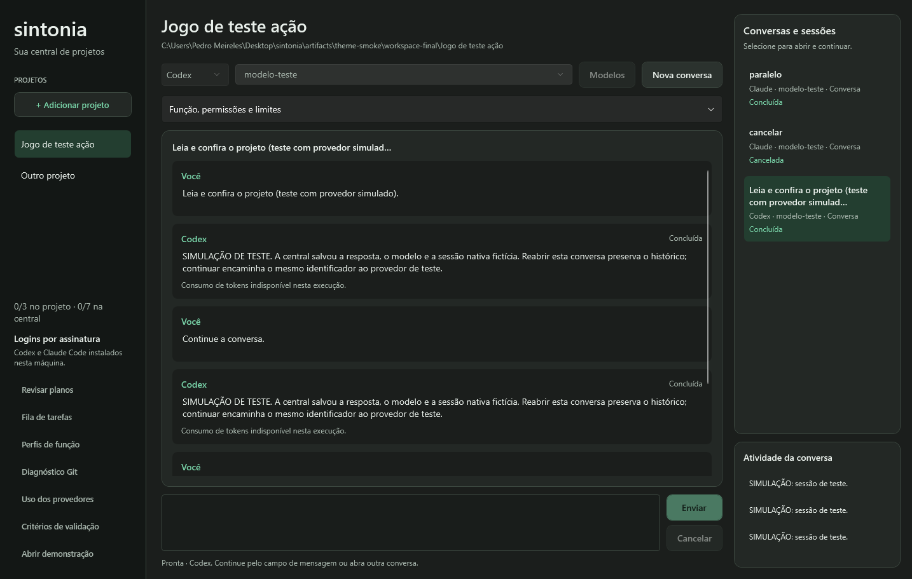

# Tema escuro do Sintonia

Aplicado em 13/10/2026 a pedido do usuário: uma interface escura e discreta, com o verde preservado como destaque. O tema usa grafite nas áreas de trabalho, superfícies próximas para organizar os painéis e verde suave em ações, seleções e foco.

## Paleta e estados

| Recurso | Cor | Uso |
| --- | --- | --- |
| Canvas | `#1B1E1C` | Fundo das janelas. |
| Sidebar | `#131715` | Navegação lateral. |
| Surface | `#232825` | Painéis e cartões. |
| SurfaceRaised | `#2B322E` | Botões secundários e cabeçalhos. |
| Input | `#191D1B` | Campos de edição e leitura. |
| Ink / Muted | `#E8EFEA` / `#A6B4AB` | Texto principal e secundário. |
| Accent / AccentInk | `#79D3A8` / `#10271B` | Verde de destaque e texto sobre botão verde. |
| Selected | `#233E30` | Seleção de projetos, conversas e itens. |

Pedidos de autorização e revisão usam superfícies âmbar; perguntas usam um painel verde discreto. Falhas na demonstração têm estado rosado. Os textos continuam identificando cada estado. Botões oferecem feedback de hover, pressionamento, desabilitação e foco de teclado.

Os pares principais da paleta têm contraste calculado entre 6,09:1 (texto secundário/superfície elevada) e 14,38:1 (texto principal/fundo). Texto escuro no botão verde: 8,81:1. Esses cálculos cobrem cores opacas da paleta; não constituem uma auditoria completa de acessibilidade ou dos estados desabilitados.

## Implementação

- [App.xaml](../src/Sintonia.Desktop/App.xaml) carrega o Fluent Dark do WPF e depois os recursos próprios.
- [Themes/Dark.xaml](../src/Sintonia.Desktop/Themes/Dark.xaml) concentra cores, brushes, cartões, legendas, botões e os estilos dos controles.
- Estilos locais de planos e listas usam `BasedOn` para preservar o tema compartilhado. Prévias, permissões e perguntas usam recursos sem cores claras fixadas nas janelas.
- Brushes dos estados Fluent ficam nos recursos do respectivo estilo, mantendo a seleção e o foco verdes independentemente da cor de destaque do Windows. Campos, combos, listas, abas, tabelas, radios, checkboxes e menus preservam os templates do framework.
- A integração utiliza o dicionário `PresentationFramework.Fluent;component/Themes/Fluent.Dark.xaml` já fornecido pelo .NET 10, conforme o [guia do WPF da versão 10.0.4](https://github.com/dotnet/wpf/blob/v10.0.4/Documentation/docs/using-fluent.md). Nenhum pacote ou runtime adicional foi introduzido.

Cobertura: central de projetos, demonstração M0, revisão de planos, fila de tarefas, perfis, diagnóstico Git, uso dos provedores, diffs, critérios de validação, validação/publicação e formulário de perguntas. Diálogos nativos de arquivos e confirmações continuam sob a aparência fornecida pelo Windows. Não há seletor de tema neste incremento.

## Validação

Builds Debug e Release sem avisos ou erros. Dez fluxos WPF aprovados: demonstração, `--workspace`, `--questions`, `--proposals`, `--profiles`, `--queue`, `--usage`, `--git`, `--publication` e `--sessions`. Provedores simulados/processos de teste, com Git real onde necessário; nenhum modelo chamado.

As capturas foram revisadas em tamanho normal e mínimo, cobrindo leitura de textos, campos, listas selecionadas, abas, tabelas, permissões, perguntas e ações de revisão/publicação. A inspeção revelou estilos locais de planos que ainda usavam controles claros e seleção herdada do sistema; ambos foram corrigidos antes do fechamento.

O executável Release local foi atualizado em `artifacts/app` e sua abertura/encerramento normal foi conferida. Os fluxos existentes verificam bindings, edição, escolha simples/múltipla, cancelamento, revisão, publicação, concorrência e reabertura; não houve mudança de regras de execução, provedores ou schema. Testes xUnit de infraestrutura não relacionados ao visual não foram repetidos.

Capturas e bancos de teste ficam em `artifacts/theme-smoke`, ignorados pelo Git. As imagens publicadas usam dados de teste e têm essa identificação no [README](../README.md); a captura histórica com respostas reais dos provedores permanece em [sintonia-central.png](images/sintonia-central.png).
