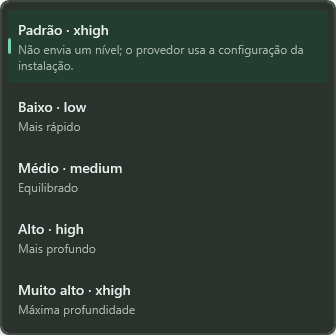

# Modelos e reasoning na central

A central mostra, para o projeto e a IA selecionados, o catálogo de modelos da instalação, o padrão configurado, a versão confirmada pela sessão e o nível de reasoning. Em conversas comuns, modelo e reasoning podem mudar entre turnos.

## Painel de modelo

- **IA:** escolhida em uma conversa nova. Depois do primeiro envio, fica fixa porque a sessão nativa pertence ao provedor.
- **Modelo:** "Padrão da instalação" não envia um modelo e segue a configuração do provedor. A lista mostra nome, identificador, marcadores de padrão da instalação/catálogo, níveis anunciados e descrição. O campo também aceita um identificador digitado, e o provedor confere o acesso no envio.
- **Reasoning:** "Padrão" não envia um nível. Os demais itens são os níveis anunciados no catálogo para o modelo escolhido. Com "Padrão da instalação", valem os níveis do modelo configurado na instalação.
- **Padrão da instalação:** no Codex, mostra modelo, reasoning e origem da configuração efetiva (usuário, perfil, projeto, configuração administrada ou pacote), sem expor camadas, caminhos ou valores brutos. No Claude, mostra o `model` e o `effortLevel` das settings do Claude Code, com a origem, e a versão que o catálogo do CLI associa ao alias (por exemplo, "Opus 5.5"). Sem essas chaves, mostra a entrada `default` do catálogo.
- **Em uso nesta conversa:** mostra a versão informada pelo provedor ao conectar a sessão. O Codex confirma o nível efetivo. No Claude, o nível aparece como solicitado porque o CLI não o confirma.

A lista de conversas mostra a versão e o nível de cada sessão. Na lista de reasoning, cada nível tem a descrição do catálogo:

## Consulta do catálogo

- A consulta é automática ao abrir um projeto ou trocar a IA. Ocorre uma vez por provedor e pasta enquanto o aplicativo está aberto; **Atualizar** repete a consulta.
- Somente metadados são lidos. Codex: `model/list` e `config/read`, sem o inventário de extensões. Claude: `auth status`, `initialize` e as chaves `model`/`effortLevel` das settings. Nenhuma mensagem ou turno é enviado ao modelo.
- O catálogo vem do CLI que o Sintonia encontra no PATH, não do binário da extensão do VS Code ou do app desktop. Cada versão do CLI tem seu próprio catálogo: o Claude Code 2.1.277 associa `opus`/`default` ao Opus 5, e o 2.1.280 os associa ao Opus 5.5. Para ver um modelo novo, atualize o CLI usado pelo Sintonia e use **Atualizar**.
- O prazo é de 60 segundos, e fechar a central cancela e aguarda a consulta. Uma falha aparece como "Consulta indisponível", sem apagar o catálogo anterior nem a escolha atual.
- Sem um projeto cadastrado não há consulta, porque o Codex lê a configuração da pasta.

## Troca entre turnos

- Em conversas comuns, modelo e reasoning podem mudar entre envios. A mesma sessão nativa é retomada com a nova escolha, e o painel avisa "Nova escolha vale no próximo envio" até o envio.
- A escolha fica bloqueada durante a execução e em conversas de tarefas da fila, que seguem o plano aprovado. O banco também recusa essas alterações.
- A escolha do usuário (por exemplo, o alias `opus`) é salva separadamente da versão confirmada (por exemplo, `claude-opus-5`). Assim, retomadas continuam usando a escolha original.

## Regras dos provedores

- **Codex:** o nível é enviado em `thread/start`/`thread/resume` e em `turn/start`. Antes do turno, o adaptador confere o suporte no catálogo e a confirmação do nível pela sessão. Se algo falhar, recusa sem iniciar o turno.
- **Claude:** usa `--model` (quando há modelo escolhido) e `--effort`. Na resposta de `initialize`, antes de enviar a mensagem, o adaptador confere se o modelo que o CLI vai usar anuncia o nível. Esse modelo é o escolhido; com "Padrão da instalação", é o `model` das settings, ou a entrada `default` do catálogo se as settings não tiverem modelo. Um modelo fora do catálogo é recusado com reasoning.
- **Settings do Claude Code:** a precedência é `ANTHROPIC_MODEL` (só para o modelo), configuração administrada, `.claude/settings.local.json` e `.claude/settings.json` do projeto e, por fim, `settings.json` do usuário (`CLAUDE_CONFIG_DIR` ou `~/.claude`). Somente `model` e `effortLevel` são projetados; `env`, hooks, permissões e demais chaves nunca são exibidos nem salvos. O `/model` de outra sessão aberta não é visto.

## Persistência

O schema 17 acrescenta `selected_model` a `conversation_model_settings`, junto com a escolha explícita ou padrão, o nível solicitado e o nível confirmado. Históricos do schema 16 recebem a coluna sem perda de dados. Em conversas antigas sem esse registro, a escolha passa a ser o último modelo salvo, como antes.

## Validação e limites

- Testes de Infrastructure cobrem escolha entre turnos sem substituição pela versão confirmada, envio sem modelo pelo padrão da instalação, migração do schema 16, bloqueio durante a execução, precedência/projeção das settings do Claude (sem vazar outras chaves) e o reasoning do Claude conferido contra o modelo explícito, o configurado ou o `default`, além dos casos anteriores do Codex.
- O fluxo WPF `--models` usa catálogos e provedores de teste. Ele cobre o padrão da instalação dos dois provedores, as listas, a troca de modelo e nível entre turnos (inclusive reasoning com o padrão do Claude), o bloqueio durante a execução, a falha de consulta e a reabertura, com zero erros de binding e capturas normal/mínima.
- Consultas reais de metadados do Claude Code em 13/10/2026, sem prompt: com o CLI 2.1.277 (PATH), as settings do usuário deram `opus`/`high`, e `opus` correspondia ao Opus 5. Com o binário 2.1.280 da extensão do VS Code, `opus` e `default` correspondiam ao Opus 5.5, com níveis de low a max. Uma consulta anterior do Codex confirmou `gpt-6.1-sol`/`xhigh` na configuração do usuário pelas mesmas leituras. Nesta sessão, o CLI Codex não estava no PATH, então `InspectModelsAsync` não foi exercitado com a instalação real.
- Nenhum turno real foi enviado com nível escolhido ou com troca de modelo entre turnos; esses fluxos foram verificados com provedores de teste. Perfis de função e propostas da chefia ainda não guardam reasoning.
