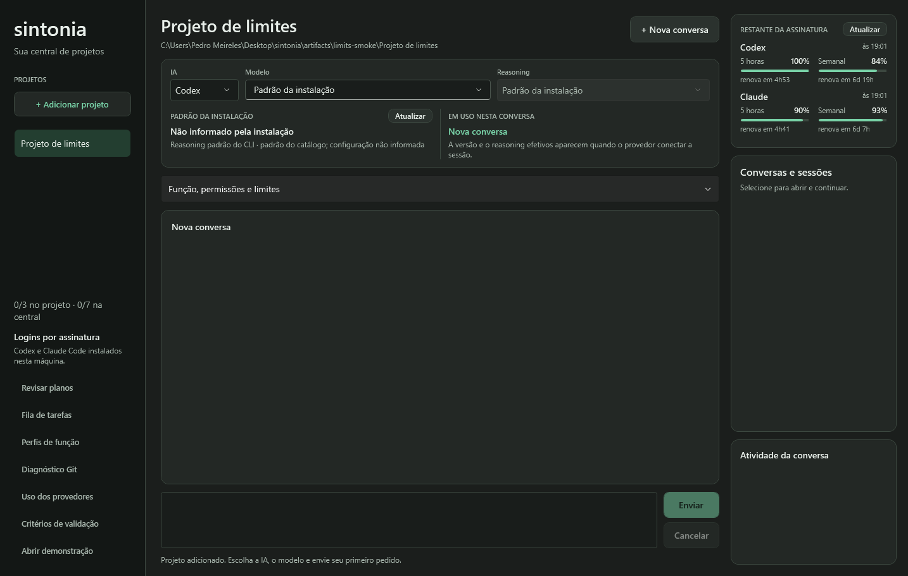

# Uso e quota dos provedores

## Restante da assinatura na central

A coluna direita da central mostra **Restante da assinatura**: para Codex e Claude, quanto resta das janelas de 5 horas e semanal, em barra e percentual, e quanto falta para renovar ("renova em 1h28", "6d 8h"). Abaixo de 20% restante, percentual e barra ficam na cor de aviso. O status indica o horário da consulta, "Uso bloqueado" (Codex com `ordinaryUsageAllowed=false`), "Indisponível" ou uma falha que conserva os dados anteriores; o motivo aparece na dica do status.

- A consulta começa ao abrir a central, repete a cada 10 minutos e roda após cada resposta (no máximo uma vez por minuto por provedor; um pedido mais próximo espera o próximo minuto). **Atualizar** consulta na hora. O contador de renovação é atualizado a cada minuto, sem nova consulta.
- Os dados são da conta inteira, compartilhados com outros aplicativos e projetos. Não são persistidos e não alteram admissão, tentativas ou orçamento de tokens, exceto pelo bloqueio explícito do Codex já descrito abaixo.
- As janelas são separadas pela duração: até um dia é a de 5 horas, o resto é a semanal. Sem duração, a janela principal é tomada como a de 5 horas.
- Sem projeto cadastrado, o Codex usa a pasta do usuário como diretório de trabalho do App Server; os limites não dependem da pasta.

## Claude: consulta `get_usage`

O Claude Code 2.1.296 oferece a requisição de controle `get_usage` no protocolo stream-json. O binário a marca como experimental, e o formato pode mudar. O Sintonia abre uma sessão sem turno (`--no-session-persistence`), confere o login por assinatura, envia `initialize` e `get_usage` com `skip_behaviors: true` (sem varrer transcrições locais) e encerra. Nenhuma mensagem de usuário é enviada.

- Somente `rate_limits.five_hour`, `rate_limits.seven_day` e, se vierem, `seven_day_opus`/`seven_day_sonnet` são lidos: `utilization` (percentual usado, arredondado) e `resets_at`. Custos da sessão, gasto, créditos, valores em dólar, plano, detalhamentos e `behaviors` são ignorados.
- `rate_limits_available=false` vira indisponibilidade explícita. A disponibilidade de uso não é inferida dos percentuais.
- Uma versão do CLI que recuse `get_usage` gera "Atualize o CLI". Formato incompatível e prazo excedido produzem mensagens genéricas, sem dados brutos.
- Uma consulta real em 13/10/2026, sem prompt, retornou as duas janelas da conta.

## Codex fora do PATH

Quando o PATH não tem o Codex, o localizador usa o CLI embutido no aplicativo Codex (`%LOCALAPPDATA%\OpenAI\Codex\bin\<pasta>\codex.exe`), escolhendo a cópia mais recente. Isso vale também para chat, catálogo e fila. Um executável no PATH continua tendo prioridade. Em 13/10/2026, nesta máquina, o CLI do aplicativo (0.162.0-alpha.17.2) respondeu a `account/rateLimits/read` sem criar thread ou turno.

## Contrato verificado

Em 09/10/2026, o Codex CLI `0.162.0-alpha.2` expõe `account/rateLimits/read` no App Server. A consulta verifica o login ChatGPT já usado pelo adaptador, lê metadados e encerra o processo sem criar thread ou turno. Uma consulta real limitada, sem inferência, confirmou janelas de uso e disponibilidade. Percentuais pessoais e identidade da conta não são registrados neste documento.

O contrato foi conferido no schema gerado pela instalação e na [documentação oficial do App Server](https://learn.chatgpt.com/docs/app-server). Até 13/10/2026, com o Claude Code `2.1.277`, nenhuma consulta equivalente ao `/usage` estava confirmada no stream-json, e o adaptador Claude retornava indisponibilidade explícita. Com o 2.1.296, a consulta `get_usage` descrita acima substitui esse comportamento. Veja a [documentação oficial de uso do Claude](https://code.claude.com/docs/en/costs).

## Dados e decisões

- O snapshot pertence à conta, compartilhada entre projetos e aplicativos. O horário indica quando a resposta foi recebida; não garante acesso futuro. Não é persistido no SQLite.
- `rateLimitsByLimitId` tem prioridade, inclusive quando vazio. O campo legado `rateLimits` só é usado se o mapa estiver ausente ou nulo. Tipos incompatíveis recusam a consulta.
- Cada categoria pode fornecer janela principal/secundária, percentual usado, duração em minutos e renovação em segundos Unix. Ausência/nulo permanecem indisponíveis. Percentual restante é `clamp(100 - usedPercent, 0, 100)`, sem saldo absoluto de assinatura, conversão para dinheiro ou estimativa de tokens.
- `ordinaryUsageAllowed` é a decisão explícita de disponibilidade do backend no schema instalado. Antes de abrir/retomar thread e iniciar cada turno Codex, uma consulta nova interrompe o envio se esse campo for `false`, mesmo com percentuais inválidos. Percentuais e horários não permitem inferir bloqueio ou recuperação. `null`, método não suportado ou consulta falha produzem diagnóstico de disponibilidade desconhecida; o próprio Codex aplica seus limites ao pedido.
- Consultas têm prazo de vinte segundos, subordinado ao cancelamento e prazo da execução. Nenhuma repetição automática, compra de créditos, reset de limites ou troca para autenticação/cobrança de API é realizada.
- Parser só conserva os campos tipados acima. Identidade da conta, créditos, cobrança e ofertas são ignorados; erros brutos do servidor não chegam ao diagnóstico da consulta. Streams continuam assíncronos e o encerramento aguarda o processo filho.

Diagnóstico manual, sem modelos: `dotnet run --project tools/Sintonia.Diagnostics -- usage Codex` ou `usage Claude`. Neste ambiente, prefixar com `rtk proxy`. A saída informa que não inicia conversa/turno e contém apenas o snapshot normalizado.

## Limites do incremento

O botão **Uso dos provedores** da central abre o painel, consulta uma vez e permite **Atualizar uso** e **Cancelar consulta**. O provedor pode ser trocado enquanto não há consulta ativa; a troca e cada atualização retiram dados anteriores. O painel conserva a pasta capturada para executar o CLI, mesmo ao navegar na central, mas exibe dados da conta inteira. Cancelamento descarta respostas tardias e mantém os controles ocupados até o leitor encerrar. Fechar o painel ou a central cancela e aguarda as consultas. Campos ausentes aparecem como indisponíveis; barras só aparecem quando há percentual informado. Horários são exibidos no fuso local, com offset.

Tokens informados por execução agora são registrados e exibidos no chat/tentativas, com escopo do agente principal e parcialidade. [Contrato de contagem](RUN_TOKEN_USAGE.md). Limites agregados de tokens/custo continuam pendentes. Um percentual da conta não pode ser atribuído a uma tarefa, e a estimativa monetária local do Claude não representa quota da assinatura. Consultas do painel/diagnóstico não alteram tentativas, concorrência ou revisão das entregas. A conferência antes do envio ocorre dentro da execução já reservada: uma recusa vira falha da tentativa pelos contratos existentes, mesmo sem iniciar turno do modelo.

Testes automatizados usam processos de protocolo simulados, sem modelos: mapa/legado, nulos, valores incompatíveis, normalização, ausência de campos, autorização explícita, 100% sem bloqueio inferido, falha, cancelamento e ausência de thread/turno na leitura. WPF `--usage` usa leitores/dados de teste e percorre atualização, troca de provedor, navegação, falha, ausência Claude, cancelamento/resposta tardia, reabertura e fechamento aguardado. Capturas normal/mínima revisadas, ações acessíveis por rolagem e zero erros de binding. Nenhum modelo chamado.
